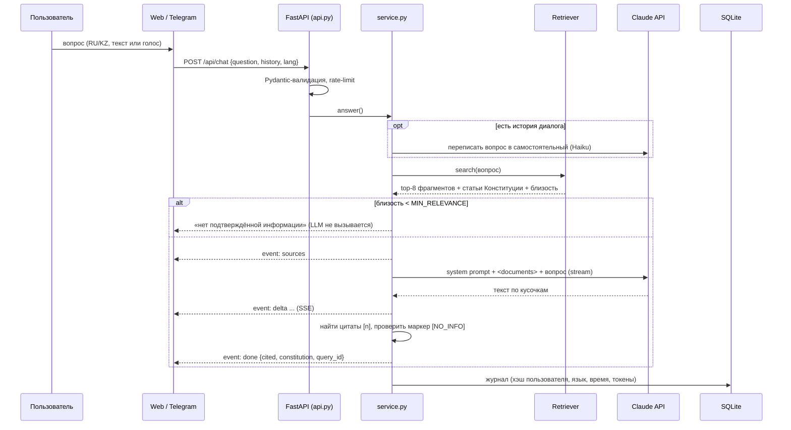

# Архитектура «Адал Кеңесші»

## 1. Компоненты

| Компонент | Файл | Ответственность |
|---|---|---|
| Frontend (Web) | `web/index.html`, `web/app.js`, `web/style.css` | Чат с потоковым выводом, карточки источников, голос, справочник, квиз |
| Frontend (Telegram) | `bot/telegram_bot.py` | Тонкий клиент к API: «живое» редактирование сообщения, кнопки-источники, нативные викторины |
| Backend API | `app/api.py` | Маршруты, валидация (Pydantic), rate-limit, CSP и др. заголовки, SSE |
| Конвейер ответа | `app/service.py` | Оркестрация: валидация → переформулировка → поиск → порог → LLM → журнал |
| RAG: нарезка | `app/rag/chunker.py` | Конституция и законы — по статьям (с разделом/главой), прочее — абзацные блоки ~1200 симв. с перекрытием |
| RAG: индекс | `app/rag/index.py` | Эмбеддинги `multilingual-e5-large` (ONNX, локально), инкрементальная сборка (кэш векторов), `embeddings.npy` + `chunks.json` |
| RAG: поиск | `app/rag/retriever.py` | Векторный + BM25 → Reciprocal Rank Fusion; разнообразие (≤3 фрагмента на документ); гарантированная проверка Конституции |
| LLM | `app/llm.py`, `app/prompts.py` | Claude API: стриминг, обработка ошибок, fallback; системный промпт с правилами достоверности |
| Database | `app/db.py` | SQLite: `queries`, `feedback`, `quiz_results`; агрегаты для аналитики |
| Сбор данных | `scripts/fetch_sources.py` | akorda.kz (поиск KZ-версий) и ИПС «Әділет» (законы в действующей редакции, отсев утративших силу), очистка служебных примечаний |

## 2. Поток данных



## 3. Ключевые решения

**Почему RAG, а не «просто ChatGPT».** Требование п. 4.9 — не выдавать недостоверную информацию. LLM без базы знаний не знает Конституцию 2026 года и будет фантазировать. RAG даёт модели только проверенные фрагменты и заставляет ссылаться на них.

**Почему гибридный поиск.** Векторный поиск понимает смысл и работает между языками (казахский вопрос → русский документ), но может промахнуться по точным терминам. BM25 надёжно ловит «Курултай», «статья 53», «Таза Қазақстан». RRF объединяет ранги без подбора весов.

**Почему Конституция режется по статьям.** Это позволяет боту точно писать «статья 3», а интерфейсу — показывать номер статьи и открывать именно её на akorda.kz. Статьи на RU и KZ сопоставлены по номеру, поэтому пользователь всегда видит статью на своём языке.

**Гарантия «укажи, если в Конституции».** Помимо общего поиска, ретривер отдельно берёт 2 лучшие статьи Конституции (если они релевантны) и добавляет их в контекст. Промпт обязывает модель написать строку «📜 Закреплено в Конституции РК 2026», но **только если** это подтверждено переданной статьёй.

**Двойная защита от выдумок.**
1. Порог близости: если ни один фрагмент не похож на вопрос, LLM даже не вызывается (экономия и надёжность).
2. Если фрагменты нашлись, но ответа в них нет, модель обязана начать с `[NO_INFO]`; сервер перехватывает маркер в потоке и показывает стандартный честный отказ.

**Локальные эмбеддинги.** У Anthropic нет API эмбеддингов; локальная модель e5 бесплатна, поддерживает казахский и не отправляет данные третьим лицам.

**Выбор модели.** Модель задаётся в `.env`: Haiku 5.5 (≈$0.0007 за ответ) для разработки и тестов, Opus 5.5 для защиты. Код не меняется.

**SSE вместо WebSocket.** Поток идёт в одну сторону (сервер → клиент), SSE проще, работает через обычный HTTP и прокси.

**Режимы.** `ask` — вопрос; `situation` — бытовое описание сначала переводится в юридические термины (дешёвый вызов Haiku), поиск идёт по обоим вариантам, ответ строится по шаблону «нормы → действия → каналы → права»; `factcheck` — модель обязана начать со служебной метки `[[VERDICT:…]]`, сервер вырезает её из потока и отдаёт отдельным событием `verdict`.

**Evidence mode.** После ответа сервер для каждой ссылки `[n]` находит в фрагменте-источнике предложение с наибольшим пересечением слов с утверждением ответа и строит ссылку `#:~:text=` прямо на это предложение.

## 4. Модель данных (SQLite)

```sql
queries(id, ts, user_hash, channel, lang, question, mode, answered, top_score, latency_ms, model, tokens_in, tokens_out, error)
feedback(query_id → queries.id, value ±1, ts)
quiz_results(id, ts, user_hash, nickname, score, total)
```

## 5. Расширение базы знаний

1. Добавить запись в `data/sources.json`: для akorda.kz — `id`, `type`, `url` RU-страницы, `date`; для закона из «Әділет» — `id`, `type: "law"`, `adilet` (код документа, например `Z1500000410`), `title_ru`, `title_kk`.
2. `python -m scripts.fetch_sources <id>` — скачает RU и найдёт KZ-версию.
3. `python -m app.rag.index` — пересобрать индекс (посчитаются только новые фрагменты).

Вопросы, на которые бот не нашёл ответа, видны в `/admin` («что добавить в базу знаний») — это цикл улучшения базы на основе реальных запросов.
