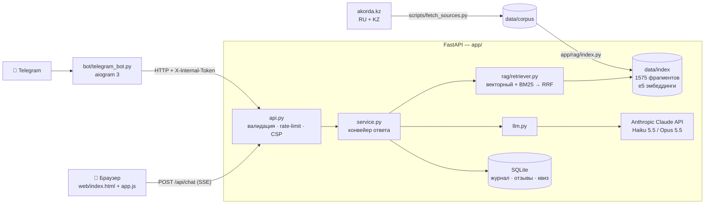

# 🇰🇿 Адал Кеңесші — AI-навигатор по внутренней политике Казахстана

> Проект конкурса AI-ботов **«Адал қоғам»** (Центр общественного развития Управления внутренней политики г. Алматы × Факультет ИИ, кибербезопасности и телекоммуникаций МУИТ).

**Адал Кеңесші** («Честный советник») — интеллектуальный справочник-навигатор, который отвечает на вопросы о **новой Конституции РК 2026 года**, Посланиях и выступлениях Главы государства, принципах и ценностях внутренней политики («Закон и Порядок», «Адал азамат», «Таза Қазақстан», «Слышащее государство» и др.) — **только по официальным документам, со ссылкой на первоисточник и на казахском и русском языках.**

| | |
|---|---|
| 🌐 Веб-демо | https://lushly-mongrel-spoof.ngrok-free.dev |
| 🤖 Telegram | [@adal_kenesshi_bot](https://t.me/adal_kenesshi_bot) |
| 📊 Аналитика | https://lushly-mongrel-spoof.ngrok-free.dev/admin (по токену) |

---

## Проблема

Официальная информация о внутренней политике разбросана по десяткам длинных документов: Конституция (96 статей), ежегодные Послания по 50–70 тыс. символов, указы, выступления. Гражданину, студенту или госслужащему сложно быстро найти, **что именно** сказано о конкретной ценности и **где** это закреплено. Обычные чат-боты на LLM при этом «галлюцинируют»: уверенно придумывают несуществующие статьи и цитаты.

## Решение

RAG-бот (Retrieval-Augmented Generation), который:

1. **Ищет** ответ в базе из 30 официальных документов (RU + KZ) гибридным поиском;
2. **Отвечает** только по найденным фрагментам, ставя ссылку `[n]` после каждого утверждения;
3. **Обязательно указывает**, если понятие закреплено в Конституции 2026 (п. 4.1 Положения);
4. **Честно отказывает**, если подтверждённой информации нет, вместо выдумки (п. 4.9 Положения);
5. Даёт **ссылку, открывающую первоисточник прямо на нужном абзаце** (Text Fragments).

## Основные функции

| Функция | Где |
|---|---|
| 💬 Ответы на естественном языке (RU / KZ), потоковый вывод в реальном времени | Web, Telegram |
| 🔗 Кликабельные ссылки `[n]` → карточка источника → первоисточник на akorda.kz с подсветкой абзаца | Web, Telegram |
| 📜 Отметка «Закреплено в Конституции РК 2026: статья N» | Web, Telegram |
| 🛡 Защита от выдумок: порог релевантности + маркер «нет информации» | Backend |
| 🧠 Память диалога: уточняющие вопросы («а что там про молодёжь?») переписываются в самостоятельные | Backend |
| 🌐 Межъязыковой поиск: вопрос на казахском находит русский текст и наоборот | Backend |
| 🎙 Голосовой ввод (ru-RU / kk-KZ) и 🔊 озвучка ответа | Web |
| 📚 Справочник 8 ключевых ценностей с отметкой о связи с Конституцией | Web, Telegram `/values` |
| 🎮 Квиз «Адал азамат» (14 вопросов, проверка на сервере, таблица лидеров) | Web, Telegram `/quiz` (нативные викторины) |
| 👍👎 Оценка ответов | Web, Telegram |
| 📊 Панель аналитики: запросы, доля найденных ответов, языки, популярные и **неотвеченные вопросы** | `/admin` |

## Демо-сценарий (3–5 минут)

1. «Какие принципы закреплены в статье 3 Конституции?» → ответ + 📜 статья 3 + переход в первоисточник.
2. «Адал азамат дегеніміз кім?» → ответ на казахском по русскому/казахскому указу.
3. Уточнение: «А как этот принцип реализуется на практике?» → бот понимает контекст.
4. Вопрос-ловушка: «Какой штраф за переход дороги на красный свет?» → честное «в базе нет подтверждённой информации».
5. Вкладка «Ценности» → «Квиз» → Telegram-бот → `/admin`.

---

## Архитектура



### Как отвечает бот (конвейер `app/service.py`)

```
вопрос → валидация (длина, управляющие символы, rate-limit)
      → [есть история диалога] переписать в самостоятельный вопрос (Claude Haiku)
      → гибридный поиск: e5-вектора (смысл, межъязыковой) + BM25 (точные термины) → RRF
      → + лучшие статьи Конституции (гарантия требования «укажи, если в Конституции»)
      → порог: max близость < 0.80 → «нет информации», LLM не вызывается
      → Claude отвечает по <documents> с цитатами [n]; маркер [NO_INFO] → честный отказ
      → журнал в SQLite (без персональных данных: только хэш)
```

Подробнее: [ARCHITECTURE.md](ARCHITECTURE.md).

## Технологии

| Слой | Технологии |
|---|---|
| LLM | **Anthropic Claude** (`claude-haiku-5-5` для разработки, `claude-opus-5-5` для демо), официальный SDK `anthropic`, потоковая генерация |
| Эмбеддинги | `intfloat/multilingual-e5-large` (локально через `fastembed`/ONNX, поддерживает казахский) |
| Поиск | NumPy (косинусная близость) + `rank-bm25` + Reciprocal Rank Fusion |
| Backend | Python 3.12, FastAPI, Uvicorn, Server-Sent Events |
| База данных | SQLite |
| Frontend | HTML/CSS/JavaScript без фреймворков, `marked` + `DOMPurify`, Web Speech API |
| Telegram | `aiogram` 3 |
| Сбор данных | `httpx`, `BeautifulSoup` |
| Тесты / деплой | `pytest` (41 тест), Docker, docker-compose |

### Внешние API

- **Anthropic Messages API** — генерация ответов и переформулировка вопросов (ключ в `.env`).
- **Telegram Bot API** — через `aiogram`.
- **akorda.kz** — источник официальных документов (только при сборке базы).

## Источники (база знаний)

Все документы — с официального сайта Президента РК **akorda.kz**, на русском и казахском языках (полный список: `data/sources.json`, вкладка «Источники» в интерфейсе):

- **Конституция Республики Казахстан 2026 г.** (принята на референдуме 15.03.2026, в силе с 01.07.2026) — 96 статей + преамбула;
- **Указ Президента РК от 5 ноября 2025 г. № 1081** «Об утверждении основных принципов, ценностей и направлений внутренней политики РК»;
- **Послания Главы государства народу Казахстана** 2019, 2020, 2021, 2022 (март и сентябрь), 2023, 2024, 2025 гг.;
- Выступления: первая сессия Қазақстан Халық Кеңесі (2026), расширенная коллегия правоохранительных органов (2025), XXXII сессия АНК, III заседание Национального курултая, поздравление с Днём Абая (2026);
- Статья «Консолидация и развитие: концептуальные основы политического курса Президента».

---

## Запуск

### Вариант 1 — локально (Python 3.12)

```bash
python3.12 -m venv .venv && source .venv/bin/activate
pip install -r requirements.txt

cp .env.example .env          # впишите ANTHROPIC_API_KEY и ADMIN_TOKEN

# (необязательно) обновить базу документов и пересобрать индекс
python -m scripts.fetch_sources
python -m app.rag.index       # ~10–15 мин на CPU, модель ~2 ГБ скачается один раз

uvicorn app.api:app --port 8000          # сайт: http://127.0.0.1:8000
python -m bot.telegram_bot               # Telegram-бот (в другом терминале)
```

### Вариант 2 — Docker

```bash
cp .env.example .env   # заполните ключи
docker compose up --build                       # только сайт/API
docker compose --profile telegram up --build    # + Telegram-бот
```

### Тесты

```bash
pytest -q
```

Тесты не тратят деньги: LLM и модель эмбеддингов заменяются заглушками.

### Переменные окружения

| Переменная | Назначение | По умолчанию |
|---|---|---|
| `ANTHROPIC_API_KEY` | ключ Claude API | — (обязательно) |
| `LLM_MODEL` | модель ответов | `claude-haiku-5-5` |
| `LLM_EFFORT` | глубина рассуждения: `low` / `medium` / `high` | `low` |
| `TELEGRAM_BOT_TOKEN` | токен от @BotFather | — |
| `ADMIN_TOKEN` | пароль панели `/admin` и секрет для Telegram-бота | — |
| `MIN_RELEVANCE` | порог «ответа нет в базе» | `0.80` |
| `TOP_K` | сколько фрагментов давать модели | `8` |
| `RATE_LIMIT_PER_MIN` | запросов в минуту на пользователя | `20` |
| `DAILY_LLM_LIMIT` | максимум ответов LLM в сутки на весь сайт (защита бюджета) | `300` |

## Безопасность и надёжность

- **Секреты** только в `.env` (в `.gitignore`), в репозитории — `.env.example`.
- **Защита от выдумок:** ответы только по документам; порог релевантности; маркер `[NO_INFO]`; запрет на утверждения о Конституции без подтверждающей статьи.
- **Prompt injection:** документы и ввод пользователя явно помечены в промпте как данные; эвристический детектор пишет попытки в журнал.
- **XSS:** ответ LLM очищается `DOMPurify`; строгий `Content-Security-Policy`, `X-Frame-Options: DENY`, `nosniff`.
- **Валидация** (Pydantic): длина вопроса, языки, размер истории; **rate-limit** на пользователя (IP берётся из адреса, добавленного прокси, — подделка `X-Forwarded-For` не помогает).
- **Защита бюджета:** дневной лимит ответов LLM на весь сайт (`DAILY_LLM_LIMIT`).
- **Персональные данные** (Закон РК «О персональных данных и их защите»): IP и Telegram ID не хранятся — только солёный SHA-256-хэш.
- **Админ-панель** защищена токеном (сравнение `hmac.compare_digest`).
- **Ошибки:** понятные сообщения на RU/KZ для сети, лимитов, ключа API; у Opus включён серверный fallback на резервную модель.
- **Docker:** приложение работает от непривилегированного пользователя, есть healthcheck.

## Структура проекта

```
app/
  api.py           HTTP API (FastAPI), заголовки безопасности, раздача сайта
  service.py       конвейер ответа: поиск → LLM → журнал
  llm.py           работа с Claude API (стриминг, ошибки, fallback)
  prompts.py       системный промпт, формат документов, тексты «нет информации»
  security.py      валидация, rate-limit, детектор prompt injection
  db.py            SQLite: журнал, отзывы, квиз, статистика
  config.py        настройки из .env
  rag/
    chunker.py     нарезка: Конституция — по статьям, остальное — по абзацам
    index.py       эмбеддинги e5 и сохранение индекса
    retriever.py   гибридный поиск (вектор + BM25 + RRF)
bot/telegram_bot.py  Telegram-бот (aiogram)
scripts/fetch_sources.py  сбор документов с akorda.kz
web/               интерфейс: index.html, app.js, style.css, admin.*
data/
  sources.json     реестр источников
  corpus/          очищенные тексты документов (RU + KZ)
  index/           векторный индекс
  concepts.json    справочник ценностей
  quiz.json        банк вопросов квиза
tests/             pytest
```

## Использованные AI-инструменты

- **Claude (Anthropic)** — LLM внутри бота.
- **multilingual-e5-large** (Microsoft / intfloat) — эмбеддинги для поиска.
- **Claude Code** — помощь в написании кода и документации (разрешено п. 7.1 Положения). Все части проекта команда разобрала и может объяснить.

## Команда

| Участник | Роль |
|---|---|
| … | Руководитель проекта / автор идеи |
| … | AI/ML / Backend-разработчик |
| … | База знаний, презентация |

## Лицензия

MIT — см. [LICENSE](LICENSE). Тексты официальных документов принадлежат их правообладателям и используются в информационных целях со ссылкой на источник.
